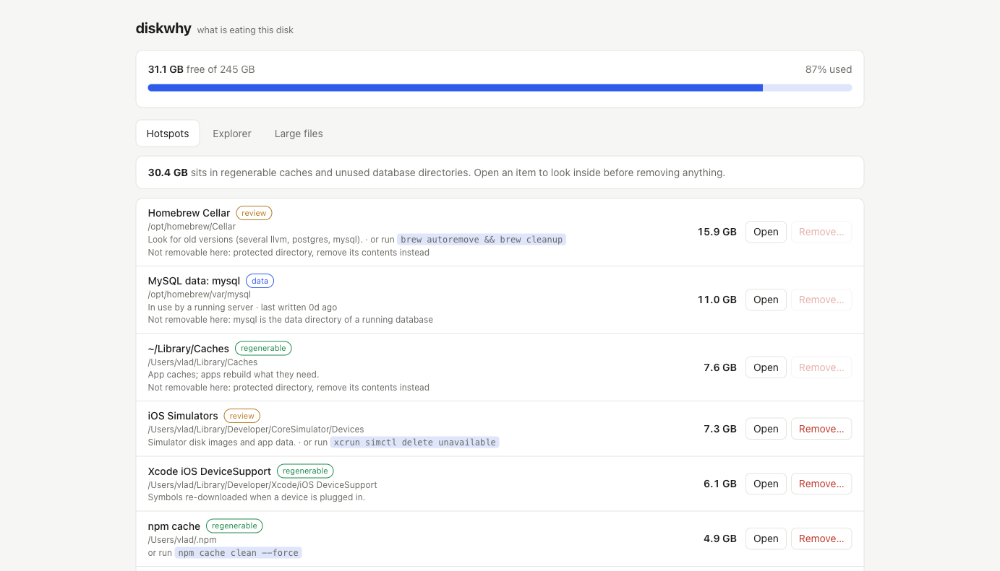

# Diskwhy

> See what is eating your disk, and clear it safely.

A local web dashboard for developer Macs. It sizes the usual space hogs (Xcode, simulators, package caches, Homebrew, Docker, stale Postgres and MySQL data directories, node_modules), lets you drill into any folder, and removes items behind strict safety guards.

## Navigation

This repository adheres to the [Studio51 Solutions Tool Standard v1](https://github.com/studio51/standards/blob/main/standards/tool/v1/STANDARD.md), with each section documented properly in its own file.

- [Architecture](docs/ARCHITECTURE.md)
- [Install & setup](docs/INSTALL.md)
- [Usage](docs/USAGE.md)
- [Changelog](CHANGELOG.md)
- [Contributing](CONTRIBUTING.md)
- [Security](SECURITY.md)

## License

Proprietary, © 2026 Studio51 Solutions. All rights reserved. See [LICENSE](LICENSE) and [COPYRIGHT](COPYRIGHT).
